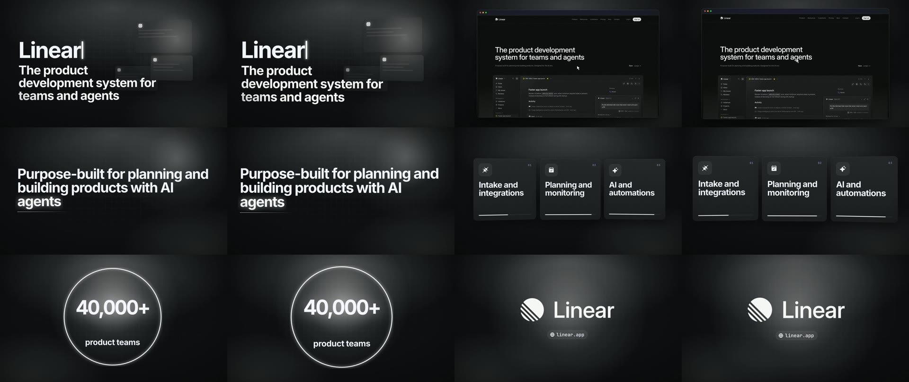

# launch-film

A 20 to 40 second launch film made from a product's own website or App Store page: its real logo, colors, fonts and screens, set in motion with music and sound effects.

```bash
npx launch-film linear.app
```



[Watch the film](.github/assets/linear-film.mp4) (28 seconds). It was made with the command above and nothing else: no brief, no edits.

Tools that make videos with code usually start from a brief: you describe the product, its colors and the style you want. launch-film starts from the site. [easybrandkit](https://github.com/EminBudak/easybrandkit) reads the logo, colors, fonts and first screen in a headless browser, the page's own headline and section titles become the film's words, and a look is picked to suit the brand. You get an MP4 at 1920x1080, rendered on your machine with Chrome and ffmpeg. There is no account, no API key and nothing is uploaded.

Read the story behind it on my blog: [launch-film: A Launch Film From Your Website](https://eminbudak.com/blog/launch-film-from-your-website/).

## Use it with your agent

launch-film ships as an [Agent Skill](https://agentskills.io). Your agent gets the brand, picks a look, writes the scenes from the page's words, renders the film, looks at its frames and hands you the MP4.

```bash
npx skills add EminBudak/launch-film
```

That covers Claude Code, Codex, Cursor and the other agents the [`skills`](https://github.com/vercel-labs/skills) CLI supports. To install it by hand instead:

**Claude Code**, as a plugin:

```
/plugin marketplace add EminBudak/launch-film
/plugin install launch-film@launch-film
```

or as a skill folder:

```bash
git clone https://github.com/EminBudak/launch-film
cp -r launch-film/skills/launch-film ~/.claude/skills/
```

**Codex**:

```bash
cp -r launch-film/skills/launch-film ~/.agents/skills/
```

**Cursor**:

```bash
cp -r launch-film/skills/launch-film ~/.cursor/skills/
```

Then ask as usual:

> Make a launch video for linear.app

## Use it from the command line

```
npx launch-film <url> [options]          read the brand, plan the film, render it
npx launch-film plan <url> [options]     read the brand and write film.json only
npx launch-film render <film.json>       render a film.json after editing it
npx launch-film frames <film.mp4>        save stills of each clip and a contact sheet
npx launch-film looks | types | icons <word> | doctor

  --out <dir>           folder for the brand, film.json and the film (default ./launch-film-<site>)
  --look <name>         launch, aurora, gridline, pop or journal (default: picked from the brand)
  --seconds <n>         aim for 20 to 40 seconds (default 30)
  --aspect 9:16         a vertical film (default 16:9)
  --brand <dir>         use an easybrandkit folder you already have
  --easybrandkit <cmd>  the easybrandkit to run (default: LAUNCH_FILM_EASYBRANDKIT, one on PATH, else easybrandkit with npx)
  --no-music, --no-sfx, --jobs <n>, --keep
```

A run leaves this behind:

```
launch-film-linear.app/
  brand/              easybrandkit's kit: logos, colors, fonts, first screen
  words.json          the words read from the page
  film.json           the plan, which you can edit and render again
  film.mp4            the film
  frames/sheet.jpg    two stills from every clip, for checking
```

## How it works

1. **Brand.** easybrandkit opens the site in headless Chrome and saves its logos cut on their own background, its button, heading and surface colors, its font families and its first screen at 2x. Given an App Store or Google Play listing, it saves the app's icon, screenshots and rating, and reads the site the listing names.
2. **Words.** The page's title, description, headline and section titles are read, with the line under each section title. Every word in the film comes from there.
3. **Plan.** A first film is planned without a brief: the name and its promise, the real screen in a browser window, the page's own sentence as a headline, three sections as feature cards, a number the page states (or an app's store rating), the app's store screenshots, and the logo close with the site's address. It is written to `film.json`.
4. **Render.** Each clip is an HTML page with one paused timeline. A virtual clock steps it frame by frame in headless Chrome, so every frame is drawn for its time however long drawing takes, and the frames go to ffmpeg. Two clips render at a time.
5. **Sound.** The music and every sound effect are synthesised in code for this film: the groove starts on the second clip, each clip lasts whole bars so cuts land on the beat, and the logo lands on a hit. There are no samples.
6. **Check.** Stills from each clip and a contact sheet are saved, so you (or your agent) can look before sharing.

## film.json

```json
{
  "brand": "brand/brand.json",
  "look": "launch",
  "aspect": "16:9",
  "clips": [
    { "kind": "scene", "bars": 2, "scene": { "type": "opener", "title": "Linear", "text": "The product development system for teams and agents" } },
    { "kind": "screen", "bars": 2, "image": "brand/screen-01.png", "mode": "pan" },
    { "kind": "scene", "bars": 2, "scene": { "type": "headline", "title": "Purpose-built for planning and building products with AI *agents*" } },
    { "kind": "scene", "bars": 2, "scene": { "type": "number", "value": "40,000+", "text": "product teams" } },
    { "kind": "logo", "bars": 2, "logo": "brand/logo-01.png", "site": "linear.app" }
  ]
}
```

| kind | what it shows |
| --- | --- |
| `scene` | type in motion; 37 types such as `opener`, `headline`, `features`, `number`, `rating`, `steps`, `quote`, `compare`, `chat` (list them with `launch-film types`) |
| `screen` | a screenshot in a browser window coming in from depth; `mode: "zoom"` with a `box` moves the camera onto one part of it |
| `shots` | two or three store screenshots side by side, coming in from depth |
| `phone` | a phone's screen capture in a drawn phone |
| `scroll` | a tall page scrolling in a window |
| `logo` | the logo close, from an easybrandkit logo file or an app icon |

Words between asterisks are set in the brand's accent color. A bar is one bar of the look's music, about two seconds; give `seconds` instead if you prefer.

## Looks

| look | | suits |
| --- | --- | --- |
| `launch` | a near-black stage with depth and soft light, type rising out of masks, one bright accent | developer tools, SaaS, dark sites |
| `aurora` | frosted glass cards over a slow aurora of the brand's colors | AI products, consumer apps, vivid brands |
| `gridline` | a light paper page with hairline columns and giant numerals, one signal color | B2B, finance, light sites |
| `pop` | full color fields that change with the cuts, sticker cards with hard shadows | consumer apps, food, games, social |
| `journal` | warm paper, newspaper rules, large serif headlines | editorial brands, publications |

## Requirements

- Node 22 or newer
- Google Chrome or Chromium (set `LAUNCH_FILM_CHROME` to use another build)
- ffmpeg (set `LAUNCH_FILM_FFMPEG` and `LAUNCH_FILM_FFPROBE` to use another build)
- [easybrandkit](https://github.com/EminBudak/easybrandkit): install it with `npm install -g easybrandkit`, or launch-film runs it with `npx -y easybrandkit` (set `LAUNCH_FILM_EASYBRANDKIT` to use a copy of your own)

Run `npx launch-film doctor` to check. It has been tested on macOS with Chrome 156 and ffmpeg 7.1.

## Limits

- The film says what the site says. A page with few section titles gives a thin first plan; edit `film.json` or let your agent write the scenes.
- A brand typeface that Google Fonts does not have is replaced by the look's own, and the render says which.
- easybrandkit needs a site that opens in a headless browser. A bot check or a login wall gets no kit, and a social profile is not a brand's site.
- A 30 second film takes one to three minutes to render on a laptop.
- The music is simple by design. To use your own track: `ffmpeg -i film.mp4 -i track.mp3 -map 0:v -map 1:a -c:v copy -shortest out.mp4`.

## License

MIT. The icons are Phosphor Icons (MIT); see [THIRD_PARTY.md](THIRD_PARTY.md) for them and for the fonts fetched at render time.
